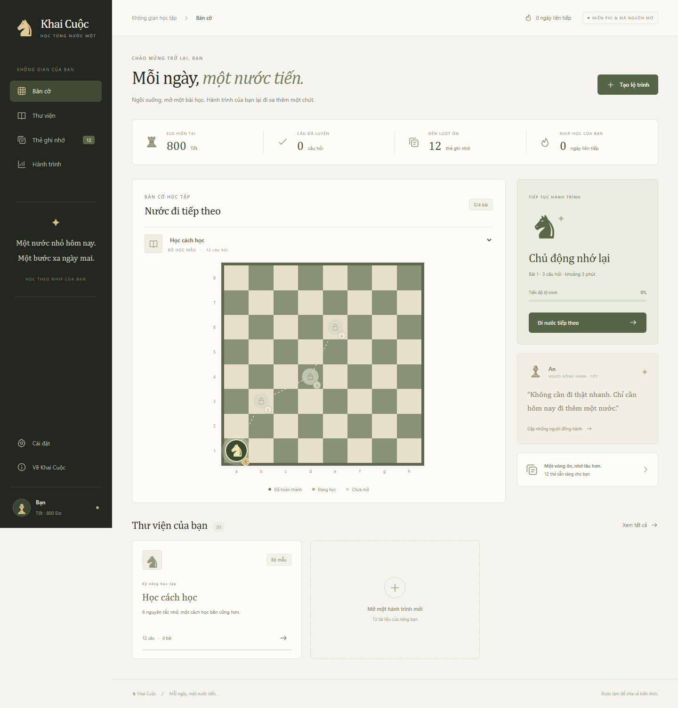

# ♞ Khai Cuộc

**Mỗi ngày, một nước tiến.** Một web tự học tiếng Việt: biến tài liệu thành quiz AI, học theo lộ trình trên bàn cờ, ôn thẻ và theo dõi Elo.

Mã nguồn mở theo MIT. Giao diện độc lập, lấy cảm hứng từ ý tưởng học bằng bàn cờ; không dùng mã nguồn, logo hay hình ảnh của Gambit Study và không liên kết với dịch vụ đó.

Repo công khai: [tenanhlatri-58/khai-cuoc](https://github.com/tenanhlatri-58/khai-cuoc). Web được triển khai tự động bằng GitHub Actions tại [tenanhlatri-58.github.io/khai-cuoc](https://tenanhlatri-58.github.io/khai-cuoc/). Bộ mẫu dùng ngay. API Cloudflare đã triển khai và kết nối; khóa OpenAI hiện cần được chủ web kiểm tra lại để bật tạo quiz AI.

API của bản triển khai này: `https://khai-cuoc-api.tenanhlatri.workers.dev/api/generate`. Khóa OpenAI được nhập trong Cloudflare, **không nhập vào giao diện học hoặc mã nguồn**.



## Chạy ngay trên máy

Cần **Node.js 22.13 trở lên**. Không cần cài dependency để chạy web hay test.

Mở terminal **trong thư mục chứa `package.json`**:

```sh
npm start
```

Mở `http://localhost:4173`. Bộ mẫu gồm 12 câu dùng ngay, không cần khóa AI.

Để bật AI trên máy:

1. Sao chép `.env.example` thành `.env`.
2. Điền `OPENAI_API_KEY` trong `.env` bằng trình soạn thảo trên máy. Không dán khóa vào mã giao diện hoặc GitHub.
3. Chạy lại `npm start`. Web tự nhận API cục bộ.
4. Nếu đặt `ACCESS_CODE`, nhập mã đó ở **Cài đặt → Kết nối AI**.

```sh
npm test
npm run build
```

`dist/` chỉ chứa giao diện tĩnh, bộ mẫu và PDF.js. Không chứa API, `.env`, tests hoặc tài liệu riêng.

## Các tính năng đã có

- Bàn cờ 8×8 với các mốc nối bằng đường đi quân mã.
- Mỗi bài tối đa 3 câu; đúng ít nhất 60% để mở bài kế tiếp.
- PDF có lớp văn bản, TXT, Markdown hoặc nội dung dán. Tối đa 10 MB, 100 trang và 60.000 ký tự mỗi lần.
- Quiz AI: 6, 12, 18 hoặc 24 câu được yêu cầu. Nếu tài liệu ngắn, AI có thể trả ít hơn, tối thiểu 3 câu.
- Mỗi câu có 4 đáp án, giải thích và trích dẫn trang. Máy chủ và trình duyệt kiểm tra trích dẫn khớp văn bản nguồn trước khi lưu.
- Elo bắt đầu từ 800. Mỗi câu chỉ cộng 12 cho lần đúng đầu và trừ 6 cho lần sai đầu; không thấp hơn 800. Luyện lại không cộng điểm vô hạn.
- Thẻ ghi nhớ ưu tiên câu từng sai. “Đã nhớ” hẹn lại sau 1, 2, 4, 8… tối đa 30 ngày; “Chưa nhớ” hẹn sau 5 phút. Có chế độ ôn tất cả.
- Sáu người đồng hành mở theo Elo, lời nhắc theo ngữ cảnh; chưa phải chatbot AI.
- Thư viện có tìm kiếm và lọc. Biểu đồ hoạt động 28 ngày dùng dữ liệu học thực.
- Lưu tiến độ bằng localStorage, tải/khôi phục sao lưu JSON, xóa lộ trình.
- Bố cục điện thoại và máy tính; không cần tài khoản để học.

PDF scan chưa có OCR. Bản này chưa có đăng nhập, đồng bộ thiết bị, học nhóm hoặc bảng xếp hạng nhiều người. AI có thể sai dù trích dẫn tồn tại; hãy đối chiếu lời giải với nguồn. Hiện hỗ trợ trắc nghiệm một đáp án, chưa sinh dạng đúng/sai hoặc điền khuyết.

## Đưa lên GitHub Pages

Đưa **nội dung thư mục này** lên thư mục gốc của một repo GitHub public. Phải có `index.html`, `package.json` và `.github/workflows/pages.yml` ở đúng vị trí, không lồng thêm thư mục `khai-cuoc/`.

Ví dụ với một repo rỗng do bạn tạo (thay URL bằng repo của mình):

```sh
git init -b main
git add .
git commit -m "Build Khai Cuoc study app"
git remote add origin https://github.com/tenanhlatri-58/khai-cuoc.git
git push -u origin main
```

Trong repo: **Settings → Pages → Build and deployment → Source → GitHub Actions**. Nếu lần push đầu chạy trước khi bật Pages, vào **Actions → Publish Khai Cuoc → Run workflow** chạy lại. Workflow chạy test, build và xuất bản `dist/`.

Địa chỉ thông thường là `https://YOUR_USERNAME.github.io/khai-cuoc/`. Đường dẫn asset là tương đối nên hỗ trợ cả repo con. Tham khảo [GitHub Pages custom workflows](https://docs.github.com/en/pages/getting-started-with-github-pages/using-custom-workflows-with-github-pages).

**GitHub Pages chỉ chạy giao diện.** Để mọi người tạo quiz AI, triển khai API bên dưới rồi kết nối URL API. Người học không cần khóa OpenAI của riêng họ nếu chủ web cung cấp API.

## Triển khai API AI bằng Cloudflare Workers

API dùng [OpenAI Responses với Structured Outputs](https://developers.openai.com/api/docs/guides/structured-outputs?api-mode=responses). Mặc định `gpt-5-mini`, có thể đổi `OPENAI_MODEL` thành model tương thích. Không gọi công cụ bên ngoài, không thực thi nội dung tài liệu, đặt `store: false` cho phản hồi.

1. Có tài khoản Cloudflare và khóa OpenAI API có hạn mức sử dụng.
2. Sửa `ALLOWED_ORIGINS` trong `wrangler.toml` thành origin GitHub Pages, ví dụ `https://an.github.io` — **không** thêm `/khai-cuoc` hoặc dấu `/` cuối.
3. Cài và đăng nhập Wrangler:

```sh
npm install --save-dev wrangler@4
npx wrangler login
npx wrangler secret put OPENAI_API_KEY
```

Lệnh `secret put` hỏi khóa trong terminal. Khóa không được đưa vào source.

4. Nếu muốn giới hạn người dùng AI bằng mã dùng chung:

```sh
npx wrangler secret put ACCESS_CODE
```

5. Triển khai:

```sh
npx wrangler deploy
```

6. Lấy URL Worker trả về, nối `/api/generate`, ví dụ `https://khai-cuoc-api.YOUR_SUBDOMAIN.workers.dev/api/generate`.
7. Để mọi người tự kết nối, nhập URL đó trong **Cài đặt → Kết nối AI**. Hoặc đặt `apiEndpoint` trong `src/config.js` rồi push lên GitHub để web dùng sẵn API của bạn.
8. Mã `ACCESS_CODE` chỉ nhập vào giao diện, không commit. Mã chỉ giữ trong phiên trang hiện tại và mất khi tải lại.

API có giới hạn **2 lượt/IP/phút** và **10 lượt/phút theo điểm phục vụ Cloudflare**. [Cloudflare rate limits](https://developers.cloudflare.com/workers/runtime-apis/bindings/rate-limit/) có tính cục bộ; đây không phải trần chi phí toàn cầu hay hệ thống chống lạm dụng hoàn chỉnh. Origin allowlist cũng không thay thế xác thực. Với API mở công khai, chủ web chịu phí AI; đặt ngân sách/kiểm soát chi tiêu ở nhà cung cấp, cân nhắc mã truy cập khi mới ra mắt. Worker hoặc nhà cung cấp cũng có thể tính phí theo gói và mức sử dụng của bạn.

## Quyền riêng tư và khóa

Nếu triển khai trực tiếp qua trình soạn mã Cloudflare: chạy `node scripts/build-worker.mjs`, dùng nội dung `worker/dashboard-worker.mjs` cho Worker. Thêm origin và hai Rate limiter đúng như `wrangler.toml`, sau đó trong **Settings → Runtime variables and secrets → Add variable** đặt Key `OPENAI_API_KEY`, bật **Secret**, nhập key và triển khai. Khi sửa mã API, tạo lại bundle bằng lệnh trên trước khi cập nhật Worker. Không dùng bản bundle cũ sau khi sửa nguồn.

- Tệp được đọc trong trình duyệt. Chỉ gửi văn bản và số trang khi người học chọn tạo quiz và đồng ý trong biểu mẫu.
- Văn bản gửi tới URL API đã cấu hình, sau đó tới OpenAI. Chỉ dùng API đáng tin. Không gửi tài liệu bạn không muốn chia sẻ với các dịch vụ đó.
- Không giữ tệp gốc hoặc toàn bộ tài liệu trong localStorage. Bộ câu hỏi, đáp án, trích dẫn, lịch ôn và tiến độ được lưu trên thiết bị.
- `store: false` không phải cam kết không lưu giữ ở mọi tầng của nhà cung cấp; xem [OpenAI data controls](https://developers.openai.com/api/docs/guides/your-data).
- Tệp sao lưu chứa nội dung quiz và trích dẫn. Giữ tệp riêng nếu tài liệu riêng tư. API URL và mã truy cập không được xuất trong bản sao lưu.
- Server mẫu không ghi log tài liệu/khóa. Nhà cung cấp hạ tầng có chính sách log riêng.
- `.env`, `.dev.vars`, `.wrangler` được bỏ qua bởi Git. Build dùng danh sách tệp cho phép để tránh đưa server và bí mật vào Pages.
- Server Node mẫu chỉ lắng nghe `127.0.0.1`, dành cho phát triển cục bộ. Dùng Worker cho môi trường công khai.

## Cấu trúc

```text
index.html, styles.css       Giao diện, không framework hay CDN
src/app.js                  Điều hướng, quiz, thẻ, biểu mẫu, PDF
src/core.js                 Dữ liệu, Elo, lịch ôn, kiểm tra sao lưu
src/config.js               URL API công khai (không chứa khóa)
api/generate.mjs            OpenAI request, JSON schema, kiểm tra nguồn
worker/index.js             API production: CORS, mã truy cập, rate limit
server.mjs                  Server phát triển và API cục bộ
wrangler.toml               Cấu hình Cloudflare
vendor/                     PDF.js 5.6.205 và giấy phép
tests/                      Unit/integration tests, không gọi API trả phí
.github/workflows/pages.yml Build và deploy GitHub Pages
```

Để tùy biến tên, màu hoặc nội dung, sửa `src/app.js`, `styles.css`, `src/core.js`. Không cần bước cài dependency cho phần giao diện.

## Kiểm thử và trạng thái bản bàn giao

- 19 bài kiểm thử tự động: điểm Elo, lịch ôn, chuỗi ngày, nguồn AI, dữ liệu sao lưu, URL API, CORS, quyền truy cập, rate limit và bản bundle dùng trong trình soạn mã Cloudflare.
- Đã thử 27 điểm kiểm tra trên trình duyệt Chrome: làm bài, mở khóa, tải lại giữ tiến độ, ôn thẻ, hồ sơ, sao lưu/khôi phục, PDF.js đọc PDF thật, tìm kiếm, tạo lộ trình qua API giả lập, phản hồi khi server chưa có khóa, các trang ở 1440px và 390px.
- Bản build tĩnh đã chạy thử ở đường dẫn con `/khai-cuoc/`, gồm cả đọc PDF bằng worker. Đã kiểm tra `dist/` không chứa server, API hay `.env`.
- Kiểm thử tự động dùng phản hồi giả lập, không gọi API trả phí. Ngày 19/10/2026 đã thử tạo 6 câu từ web công khai qua Worker thật: kết nối tới OpenAI hoạt động nhưng nhà cung cấp trả lỗi xác thực/quyền truy cập (401 hoặc 403). Chưa tạo thành công bộ câu hỏi AI thật.
- Cloudflare Worker `khai-cuoc-api` đã triển khai với origin GitHub Pages, hai rate limiter và secret `OPENAI_API_KEY`. Chủ web cần cập nhật secret bằng khóa OpenAI hợp lệ có quyền dùng model `gpt-5-mini`, rồi Deploy và thử lại. Không đưa khóa vào GitHub hoặc URL API.

## Giấy phép

Mã dự án: [MIT](LICENSE). PDF.js: Apache-2.0, xem [thông báo bên thứ ba](THIRD_PARTY_NOTICES.md). Tài liệu do người học tải lên vẫn thuộc chủ sở hữu của tài liệu đó.
